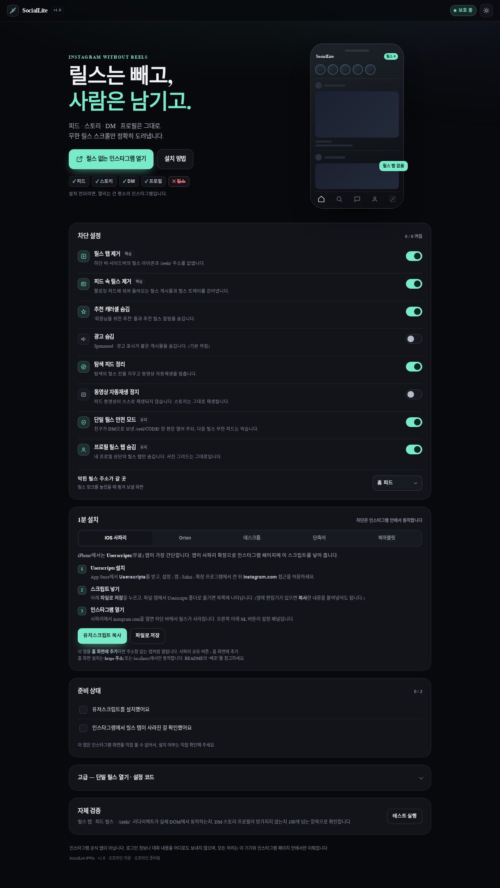
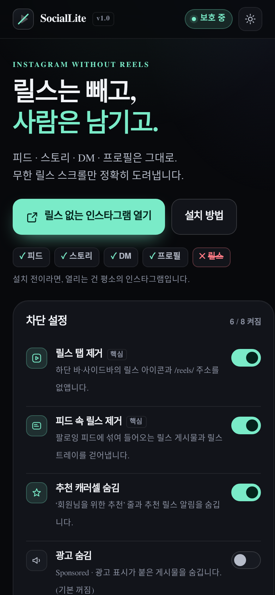
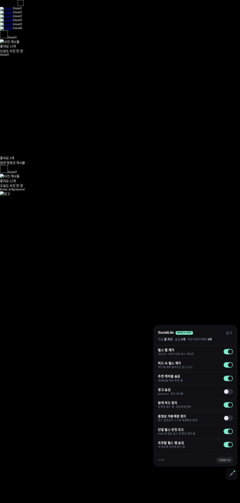
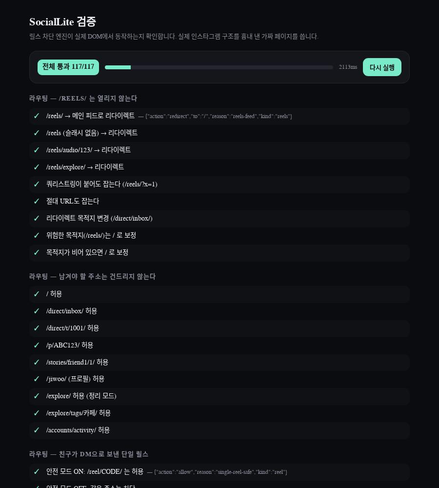

# SocialLite — 릴스 없는 인스타그램

인스타그램에서 **릴스(숏폼 무한 피드)만** 도려내고, 원래 쓰던 소통 기능은 그대로 남기는 앱입니다.
레퍼런스: [SocialLite — Instagram without Reels](https://sociallite.app/instagram-without-reels/)

| 사라지는 것 | 그대로 남는 것 |
| --- | --- |
| 하단 바·사이드바의 **릴스 탭** | 1:1 · 그룹 **DM** (`/direct/inbox/`) |
| 피드에 섞여 들어오는 **릴스 게시물·릴스 트레이** | 팔로잉 계정의 **사진·카드뉴스·일반 동영상** |
| `/reels/` 주소(무한 스크롤 피드) | **스토리** 트레이와 스토리 뷰어 |
| 탐색 피드의 **릴스 칸 · 자동재생** | **프로필 · 검색 · 알림** |
| (켜면) 추천 캐러셀 · 광고 | 친구가 DM으로 보낸 **릴스 한 편**(안전 모드) |

> ℹ️ 인스타그램 **앱 자체**를 고칠 수는 없습니다(앱은 외부에서 수정 불가).
> SocialLite는 **사파리·크롬에서 여는 인스타그램 웹**에서 동작하며, 이 앱(대시보드)이 그 설치와 설정을 담당합니다.



---

## 1분 실행

### A. iPhone · 사파리 (권장)

1. 아래 **배포**로 `https://` 주소를 만들고(로컬 서버도 가능) 사파리로 접속 → **공유 › 홈 화면에 추가**.
   홈 화면의 **SocialLite** 앱을 열면 주소창 없는 앱으로 뜹니다.
2. App Store에서 **Userscripts**(무료) 설치 →
   `설정 › 앱 › Safari › 확장 프로그램 › Userscripts` 를 켜고 **instagram.com 접근 허용**.
3. 대시보드에서 **유저스크립트 복사** → Userscripts 폴더에 저장(또는 **파일로 저장** 후 파일 앱에서
   Userscripts 폴더로 이동).
4. 사파리에서 **instagram.com** 접속. 하단 바에서 릴스가 사라졌으면 끝.
   인스타그램 오른쪽 아래 **SL** 버튼이 설정 패널입니다.

### B. 데스크톱 (Chrome · Edge · Firefox · Safari)

1. Tampermonkey 또는 Violentmonkey 설치.
2. 대시보드에서 **유저스크립트 복사** → 확장의 *새 스크립트*에 붙여넣고 저장.
3. instagram.com 새로고침.

### C. 설치 없이 (북마클릿)

`install-bookmarklet.html` 을 열고 안내대로 북마크 주소를 `javascript:` 코드로 바꿉니다.
새로고침하면 풀리므로 필요할 때마다 눌러 쓰는 방식입니다.

### D. iOS 단축어(Shortcuts)와 묶기

차단은 유저스크립트가 하고, 단축어는 “어디로 열지”를 정합니다.

1. **릴스 없는 인스타 열기** — 단축어 앱 › 새 단축어 › `URL 열기` 동작에 대시보드의 **실행 URL**
   (`instagram.com/#sl=<설정>`)을 붙여넣고, 이름을 “릴스 없는 인스타”로 저장 → 홈 화면에 추가.
2. **공유 시트로 받은 릴스** — 인스타그램 앱에서 릴스를 공유 › 단축어로 실행하면, 받은
   `instagram.com/reel/CODE` 주소를 사파리로 넘겨 **한 편만** 보는 안전 모드로 엽니다.
3. **자동화(선택)** — 단축어 › 자동화 › 앱 열림에서 인스타그램을 고르고 위 단축어를 실행하게 하면
   앱을 열 때마다 사파리로 넘어갑니다(iOS가 확인을 요구할 수 있음).

### 로컬에서 열기

```sh
cd apps/socialite-instagram
./serve.sh            # → http://localhost:5173/
```

Node는 필요 없습니다(정적 파일 + 파이썬 한 줄). `package.json` 의 `npm start` 도 같은 서버를 띄웁니다.

### 배포 (iPhone에서 쓰려면 필요)

iPhone은 이 컴퓨터의 `localhost`에 접속할 수 없고, **홈 화면에 추가**와 서비스 워커는 `https://`
(또는 localhost)에서만 동작합니다. 정적 파일만 있으므로 아래 아무 방법이나 1분이면 됩니다.

```sh
# 1) GitHub Pages (gh CLI 로그인 상태)
cd apps/socialite-instagram
git init -b main && git add . && git commit -m "SocialLite v1.0"
gh repo create socialite --public --source=. --push
gh api -X POST repos/{owner}/socialite/pages -f source[branch]=main -f source[path]=/
# → https://<owner>.github.io/socialite/

# 2) Vercel
npx vercel deploy --prod        # 또는 vercel.com 에 폴더를 끌어다 놓기

# 3) Netlify
# app.netlify.com/drop 에 이 폴더를 끌어다 놓기
```

배포 후 그 주소를 사파리로 열고 **공유 › 홈 화면에 추가** 하면 앱처럼 뜹니다.

---

## 설정 (8가지)

| 설정 | 기본 | 하는 일 |
| --- | --- | --- |
| 릴스 탭 제거 | 켜짐 | 하단 바·사이드바의 릴스 아이콘과 `/reels/` 링크 제거 |
| 피드 속 릴스 제거 | 켜짐 | 피드에 섞인 릴스 게시물·릴스 트레이 제거 |
| 추천 캐러셀 숨김 | 켜짐 | "회원님을 위한 추천" 줄, 추천 릴스 알림 |
| 광고 숨김 | **꺼짐** | `Sponsored`·`광고` 표시가 붙은 게시물 |
| 탐색 피드 정리 | 켜짐 | 탐색의 릴스 칸 제거 + 동영상 자동재생 정지 |
| 동영상 자동재생 정지 | 꺼짐 | 피드 동영상 자동재생 정지(스토리는 유지) |
| 단일 릴스 안전 모드 | 켜짐 | `/reel/CODE/` 한 편은 허용, 다음 릴스 무한 피드는 차단 |
| 프로필 릴스 탭 숨김 | 켜짐 | 내 프로필 상단의 릴스 탭만 숨김(그리드는 유지) |

- 설정은 **대시보드**와 **인스타그램 안 SL 패널** 양쪽에서 바꿀 수 있고, 즉시 반영됩니다.
- 대시보드의 **릴스 없는 인스타그램 열기** 는 `instagram.com/#sl=<설정>` 으로 열어, 설치된 스크립트에
  그때의 설정을 전달합니다(다음 방문을 위해 저장도 됩니다).
- 막힌 릴스 주소가 갈 곳은 **홈 피드** 또는 **DM 받은편지함** 중에 고릅니다.

---

## 스크린샷

| 대시보드(모바일) | 인스타그램 안 SL 패널 | 자체 검증 |
| --- | --- | --- |
|  |  |  |

## 동작 원리 (기술 메모)

- **선택자 원칙**: 인스타그램이 매일 바꾸는 해시 클래스(`x1abc…`)는 쓰지 않습니다.
  `href` · `aria-label` · `role` · 태그 구조 · 화면 문구처럼 오래 유지되는 신호만 씁니다.
- **지우지 않고 숨깁니다**: React가 관리하는 노드를 DOM에서 제거하면 재조정이 깨져 DM 입력창이나
  스토리 뷰어가 멈출 수 있습니다. 그래서 `[data-sl-hidden]` 속성 + `display:none` 으로만 처리합니다.
- **3중 라우팅 가드**: ① 링크 클릭 가로채기 → ② `history.pushState` 패치 → ③ 0.8초 폴링.
  `/reels/`, `/reels/audio/…`, `/<user>/reels/` 는 각각 홈(또는 DM)·프로필로 되돌립니다.
  같은 리다이렉트가 2초 안에 반복되면 루프로 보고 새로고침하지 않습니다.
- **동적 DOM**: `MutationObserver`(childList + href/aria-label/role 속성) + rAF 스로틀로 배치 처리.
  스윕은 멱등이며 400개 게시물 기준 120ms 이내입니다.
- **안전 모드**: `/reel/CODE/` 에서는 지금 보는 릴스만 남기고 다음/이전 화살표·추천 릴스 목록을 숨깁니다.

## 파일 구성


```
index.html               대시보드(PWA) — 실행·설정·설치
style.css                다크/라이트 테마
app.js                   설정 저장, 유저스크립트 맞춤 생성, 실행 링크
manifest.json / sw.js    홈 화면 설치 · 오프라인
icons/                   앱 아이콘 · iOS 스플래시
reels-blocker.js         차단 엔진(코어) — 라우팅 · CSS 생성 · 스윕 · 옵저버
reels-blocker.css        정적 CSS 베이스라인(JS 없이도 동작)
userscript-ui.js         인스타그램 안 SL 설정 패널(Shadow DOM)
socialite.user.js        설치용 유저스크립트 (build.py 결과물)
bookmarklet.js           북마클릿 (build.py 결과물)
install-bookmarklet.html 북마클릿 설치 도우미
build.py                 위 두 파일을 코어에서 다시 만든다
test_blocker.js          검증 스위트(117항목)
tests/index.html         검증 실행 화면
serve.sh                 로컬 서버
tools/run_tests.py       헤드리스 검증(선택, playwright)
tools/make_icons.py      아이콘 재생성
```

## 자체 검증

브라우저에서 **`/tests/`** 를 열면 바로 실행됩니다(117항목, 약 2초).
실제 인스타그램 구조를 흉내 낸 가짜 DOM을 iframe에 띄우고 **진짜 CSS·DOM**으로 확인합니다.

```sh
python3 build.py                 # 유저스크립트·북마클릿 재생성
python3 tools/run_tests.py       # 헤드리스 실행(playwright 필요)
```

검증 항목 요약:

- 라우팅: `/reels/`·`/reels/audio/…`·`/<user>/reels/` 리다이렉트, `/reel/CODE/` 안전 모드, 위험한 목적지 보정
- 홈 피드: 릴스 탭·피드 릴스·릴스 트레이·추천 캐러셀 제거 / 사진·일반 동영상·스토리 유지
- DM: 대화 목록·공유된 릴스·입력창 유지 (한 개도 건드리지 않음)
- 스토리 뷰어: 자동재생 정지 설정에서도 살아 있음
- 프로필: 릴스 탭만 숨김, 그리드 10칸 유지 / 탐색: 릴스 칸만 제거
- 단일 릴스: 화살표·추천 목록 제거, 안내 배너 표시
- 동적 DOM·실시간 설정·`stop()`·멱등성·성능
- 정적 CSS 단독 동작, 유저스크립트 실행, `#sl=` 설정 적용, 북마클릿 실행

## 안전성

- 로그인 정보·대화 내용을 **읽지도, 보내지도 않습니다.** 네트워크 요청을 추가하지 않습니다.
- 모든 처리는 인스타그램 페이지 안(스타일 + 속성)과 이 기기의 `localStorage` 에서만 이뤄집니다.
- 인스타그램 공식 앱이 아니며, 계정 제재와 무관하게 **화면 표시만** 바꾸는 도구입니다.

## 알려진 한계

- **인스타그램 앱(iOS/Android)** 안에서는 동작하지 않습니다. 사파리·크롬의 웹에서만 동작합니다.
- 인스타그램이 화면 구조를 크게 바꾸면 선택자를 손봐야 합니다. 그때는 `reels-blocker.js` 의
  `buildCss()` 와 `sweep()` 셀렉터만 고치면 되고, `tests/` 로 즉시 회귀 확인이 됩니다.
- 인스타그램 내부 브라우저(다른 앱에서 링크로 열린 화면)에서는 확장이 걸리지 않습니다.
- 광고 숨김은 기본 꺼짐입니다(게시물 누락 위험을 줄이기 위해).

MIT License.
